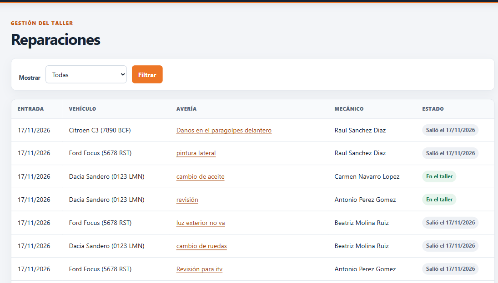
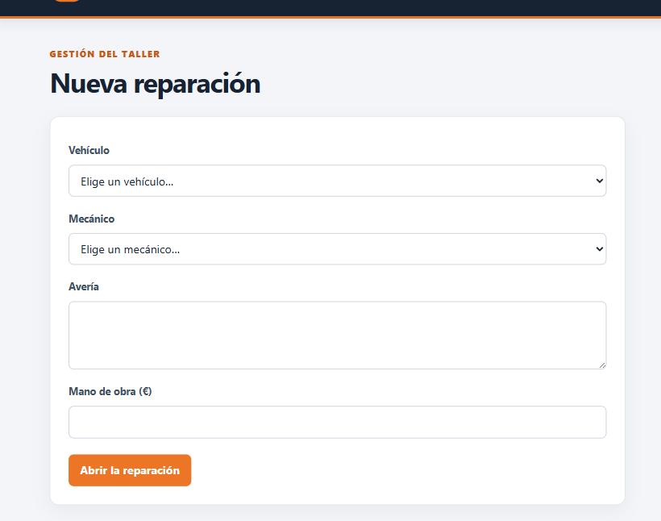
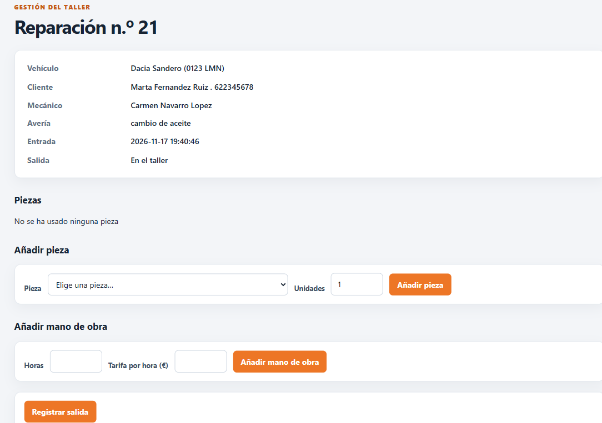
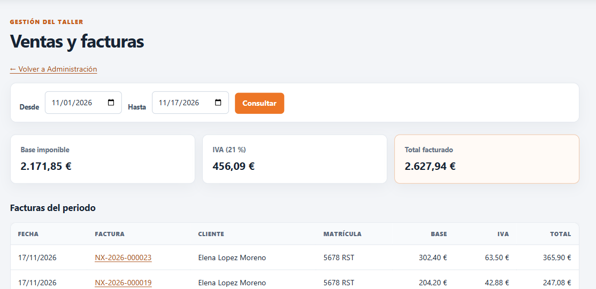
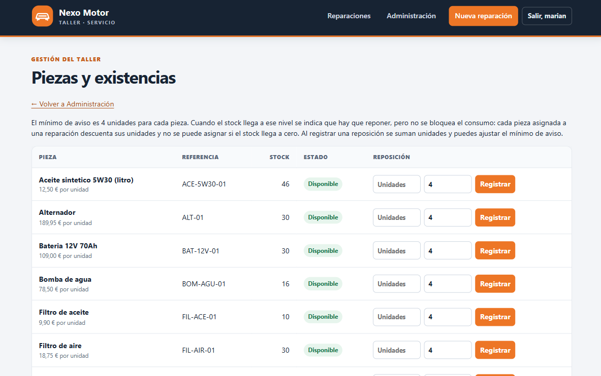

# Nexo Motor · Gestión de taller

Aplicación web sencilla para llevar las reparaciones de un taller mecánico. Permite consultar los trabajos en curso, registrar piezas y horas de mano de obra, cerrar reparaciones y preparar una factura imprimible.

## Funciones

- Listado de reparaciones con filtro por estado: en el taller, finalizadas o todas. El listado inicial muestra las que siguen abiertas.
- Ficha de reparación con vehículo, cliente, mecánico, avería, piezas y costes.
- Alta de reparaciones seleccionando vehículo y mecánico.
- Registro de piezas. Si se añade de nuevo una pieza a la misma reparación, se suman las unidades existentes.
- Registro de mano de obra adicional mediante horas y tarifa por hora. El coste se suma al importe de mano de obra ya guardado; las reparaciones cerradas no se pueden modificar.
- Cierre de la reparación con fecha de salida.
- Factura imprimible, disponible al cerrar la reparación, con base imponible e IVA del 21 %.
- Acceso con sesión y cierre de sesión; las operaciones POST usan protección CSRF.
- Administración con resumen de facturas de reparaciones cerradas por intervalo de fechas.
- Inventario de piezas con existencias y mínimo. Reponer suma unidades, añadirlas a una reparación las descuenta y quitarlas de una reparación abierta las devuelve al almacén.

## Guía visual

### 1. Iniciar sesión

Introduce el usuario y la contraseña configurados localmente para acceder al taller.


### 2. Filtrar reparaciones

En el listado puedes mostrar las reparaciones abiertas, las finalizadas o todas.



### 3. Registrar una reparación

Selecciona el vehículo y el mecánico, describe la avería e indica el coste inicial de mano de obra.



### 4. Añadir piezas y mano de obra

En la ficha de una reparación abierta puedes añadir piezas según las existencias y registrar horas adicionales con su tarifa. Al quitar una pieza, las unidades vuelven al almacén.



### 5. Consultar ventas y facturas

El informe administrativo filtra por fechas y resume base imponible, IVA y total. Cada fila permite abrir la factura imprimible.



### 6. Reponer piezas y revisar el stock

La pantalla de almacén muestra las existencias y permite registrar reposiciones. El mínimo inicial de aviso es de cuatro unidades: avisa cuándo reponer, pero no bloquea el consumo; no se puede asignar una pieza cuando el stock llega a cero.



## Requisitos

- PHP 8.2 o posterior con las extensiones `PDO` y `pdo_mysql`.
- MySQL o MariaDB.
- Para desarrollo local en Windows: XAMPP con Apache y MySQL activos.

## Instalación con XAMPP

1. Coloca el proyecto en `C:\xampp\htdocs\taller-mecanico`.
2. Inicia Apache y MySQL desde el panel de XAMPP.
3. En phpMyAdmin, crea una base de datos vacía, por ejemplo `taller_mecanico`.
4. Selecciona esa base de datos e importa `datos/taller_mecanico.sql` para crear las tablas.
5. Si quieres cargar registros de ejemplo, importa después `datos/datos_prueba.sql`.
6. Si aún no tienes `config/config.php`, copia `config/config_example.php` a esa ruta y completa los datos de conexión:

   ```php
   <?php
   $servidor = "localhost";
   $nombreBase = "taller_mecanico";
   $usuario = "root";
   $password = "";
   ```

   Ajusta usuario, contraseña y nombre de base de datos a tu instalación local. No sobrescribas un `config/config.php` que ya tenga tu configuración correcta ni publiques sus credenciales.

7. Configura el acceso local. Copia `config/auth_example.php` como `config/auth_local.php` y sustituye el texto de `password_hash` por el resultado de `password_hash('TU_CONTRASEÑA', PASSWORD_DEFAULT)`. No incluyas la contraseña directamente en ese archivo. `auth_local.php` está ignorado por Git.
8. Abre `http://localhost/taller-mecanico/` e inicia sesión.

El usuario local inicial es `marian`. Cambia la contraseña configurada antes de exponer la aplicación fuera de tu ordenador. Para cambiarla, genera un hash nuevo con `password_hash()` y actualiza `config/auth_local.php`.
Si ya tenías una base de datos importada antes del control de stock, ejecuta una sola vez `datos/migracion_inventario.sql`. Si ya añadiste esas columnas, ejecuta una sola vez `datos/migracion_stock_minimo_4.sql` para establecer el umbral inicial de cuatro unidades.

> Importa el esquema solo en una base vacía. La importación de datos de ejemplo también requiere tablas sin registros con esos mismos identificadores.

## Uso habitual

1. En **Reparaciones**, filtra por estado y abre una reparación para consultar su ficha.
2. En **Nueva reparación**, elige vehículo y mecánico, describe la avería e introduce el importe inicial de mano de obra en euros.
3. Mientras siga abierta, desde la ficha puedes añadir piezas y horas adicionales. Para cada registro de mano de obra se introduce la tarifa por hora; el importe calculado se acumula al coste inicial.
4. Pulsa **Registrar salida** cuando se entregue el vehículo. Desde ese momento no se pueden añadir piezas ni mano de obra.
5. En la ficha cerrada, selecciona **Imprimir factura**. El botón de impresión desaparece al imprimir.
6. Desde **Administración**, consulta ventas/facturas por fechas o revisa y repón existencias en **Piezas**. El inventario comienza en cero y el mínimo de aviso en cuatro: registra las existencias reales antes de empezar a consumir piezas.

## Rutas principales

El punto de entrada es `index.php`; la acción se selecciona con el parámetro `accion`.

| Acción | Uso |
| --- | --- |
| `listado` | Listado y filtro de reparaciones |
| `ver&id=ID` | Ficha de una reparación |
| `nueva` | Formulario para abrir una reparación |
| `guardar` | Guardar el formulario de alta mediante `POST` |
| `anadirPieza&id=ID` | Añadir una pieza mediante `POST` |
| `anadirManoObra` | Añadir horas y tarifa mediante `POST` |
| `cerrar` | Anotar la salida mediante `POST` |
| `factura&id=ID` | Factura imprimible de una reparación cerrada |
| `seccion=administracion` | Inicio de Administración |
| `seccion=administracion&accion=ventas` | Resumen y facturas por fechas |
| `seccion=administracion&accion=inventario` | Existencias y reposición de piezas |
| `seccion=administracion&accion=reponer` | Registrar reposición mediante `POST` |
| `accion=quitarPieza` | Devolver al stock una pieza quitada mediante `POST` |
| `login.php` / `logout.php` | Inicio y cierre de sesión |

Si no se indica una acción, se abre el listado.

## Estructura del proyecto

- `index.php`: carga la aplicación y despacha las acciones.
- `controladores/ReparacionesControlador.php`: valida las peticiones y decide qué vista mostrar.
- `modelos/`: consultas y operaciones sobre reparaciones y catálogos.
- `vistas/`: páginas y componentes HTML.
- `config/`: conexión PDO y configuración local.
- `datos/`: esquema de la base de datos y registros de ejemplo.
- `estilos.css`: estilos y reglas de impresión.

## Datos y cálculos

- `reparacion.mano_obra` contiene el coste de mano de obra en euros, incluido el importe inicial y los incrementos posteriores.
- `reparacion.horas_mano_obra` acumula las horas añadidas después de abrir la reparación.
- `piezas_reparacion` relaciona reparaciones y piezas. La pareja `(id_reparacion, id_pieza)` es única; la clave primaria `id` se conserva.
- La factura calcula el subtotal sumando mano de obra y piezas, aplica un IVA fijo del 21 % y muestra el total.

La factura es una plantilla básica: el proyecto no almacena datos fiscales del taller ni una numeración fiscal independiente.
El informe de Administración usa las reparaciones cerradas dentro del intervalo elegido y calcula base imponible e IVA del 21 %. Es un resumen de apoyo para la gestoría, no un libro fiscal ni una factura electrónica. Las existencias se inicializan a cero al importar el esquema; registra el inventario real desde Administración.
